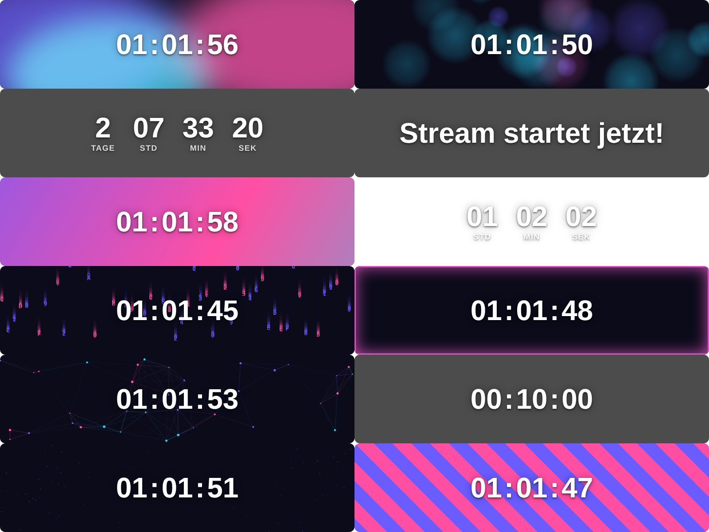

# OBSTimer

Ein Countdown-Script für OBS Studio. Es wird direkt in OBS unter **Werkzeuge → Skripte** geladen. Du stellst alles im Skript-Fenster ein und steuerst den Timer über Buttons oder Hotkeys. Als Hintergrund gibt es transparent, einfarbig oder einen von neun animierten Stilen.

## Funktionen

- **Zwei Modi:** eine feste Dauer (z. B. 10 Minuten) oder eine Zielzeit (z. B. 20:00 Uhr)
- **Anzeige:** Tage und Stunden lassen sich einzeln ein- und ausblenden, dazu optionale Beschriftungen (Tage/Std/Min/Sek) und ein Textschatten
- **Position:** neun Positionen (oben/Mitte/unten × links/Mitte/rechts) mit einstellbarem Abstand zum Rand
- **Text bei Ablauf**, z. B. „Stream startet jetzt!“
- **Schrift, Größe, Fett/Kursiv und Textfarbe** über die normalen OBS-Dialoge
- **Hintergrund:** transparent, einfarbig (mit Deckkraft und Eckenradius) oder animiert
- **Animierte Stile:** Farbverlauf, Aurora, Wellen, Partikel-Netz, Sternenflug, Bokeh, Neon-Puls, Streifen und Matrix. Für jeden Stil kannst du drei Farben, eine Grundfarbe und die Geschwindigkeit einstellen.
- **Steuerung:** Start/Pause, Zurücksetzen, +1 Minute, −1 Minute, jeweils als Button und als Hotkey
- **Automatik:** Der Timer startet von selbst, wenn eine bestimmte Szene aktiv wird. Bei Ablauf kann OBS automatisch zu einer anderen Szene wechseln.

## Installation

1. Lade `obstimer.lua` und `obstimer.html` herunter und lege beide **in denselben Ordner**.
2. Öffne in OBS **Werkzeuge → Skripte**, klicke auf **+** und wähle `obstimer.lua`.
3. Klicke im Skript-Fenster auf **Browserquelle „OBSTimer“ in aktueller Szene erstellen**. Alternativ wählst du eine vorhandene Browserquelle aus.
4. Stelle Zeit und Aussehen ein und klicke auf **Start / Pause**.

Die Hotkeys legst du unter **Einstellungen → Hotkeys** fest. Sie stehen dort unter „OBSTimer: …“.

## Hinweise

- Die Browserquelle ist standardmäßig 1920 × 1080 px groß, also so groß wie eine Full-HD-Szene. Der Countdown sitzt darin an der gewählten Position. Breite und Höhe kannst du im Script ändern.
- Für die Fehlersuche kannst du in `obstimer.lua` `DEBUG = true` setzen. Dann schreibt das Script jeden Schritt ins OBS-Log.
- Bei Start, Pause und Zurücksetzen lädt die Browserquelle kurz neu. Dadurch beginnt auch die Hintergrund-Animation von vorn.
- Im Modus **Zielzeit** liegt die Uhrzeit immer in der Zukunft. Ist sie heute schon vorbei, zählt der Timer bis zu dieser Uhrzeit am nächsten Tag.
- `obstimer.html` kannst du zum Ausprobieren auch direkt im Browser öffnen, z. B. mit `obstimer.html?state=run&end=9999999999999&bg=anim&anim=aurora`.

## Dateien

| Datei | Zweck |
|---|---|
| `obstimer.lua` | Das OBS-Script mit Einstellungen, Hotkeys und Timer-Logik |
| `obstimer.html` | Die Anzeige, die in der Browserquelle läuft (Countdown und Hintergründe) |
